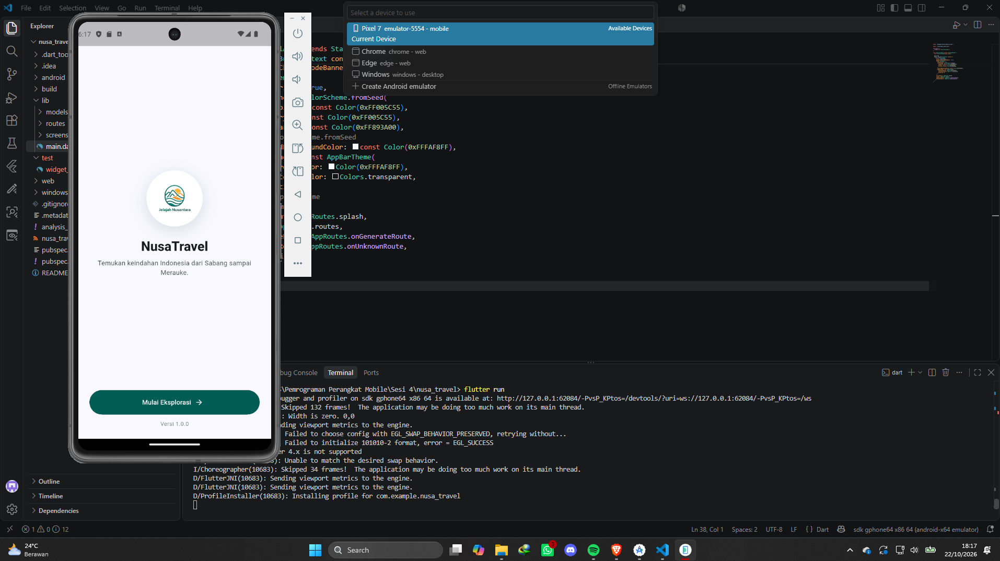
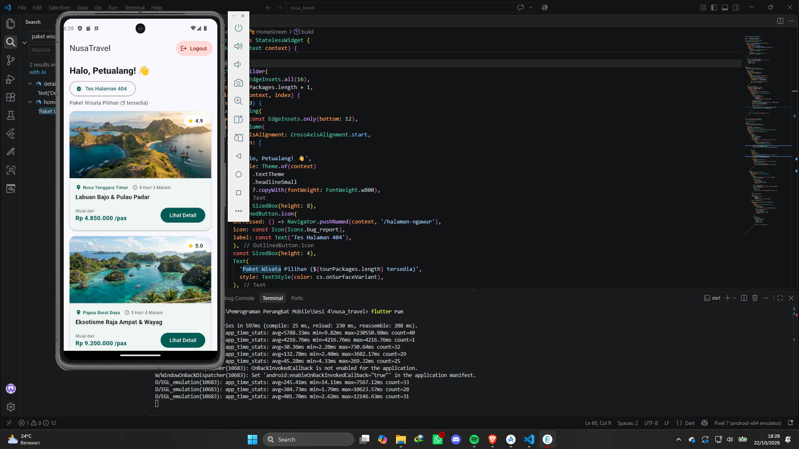
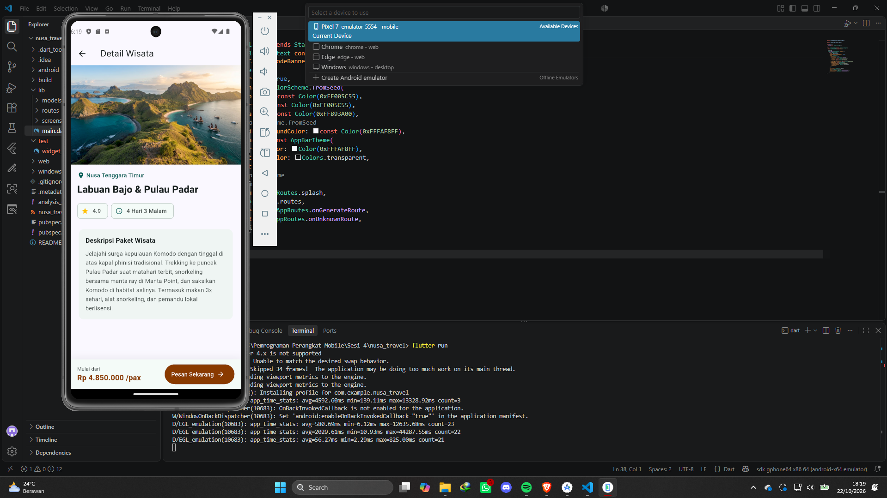
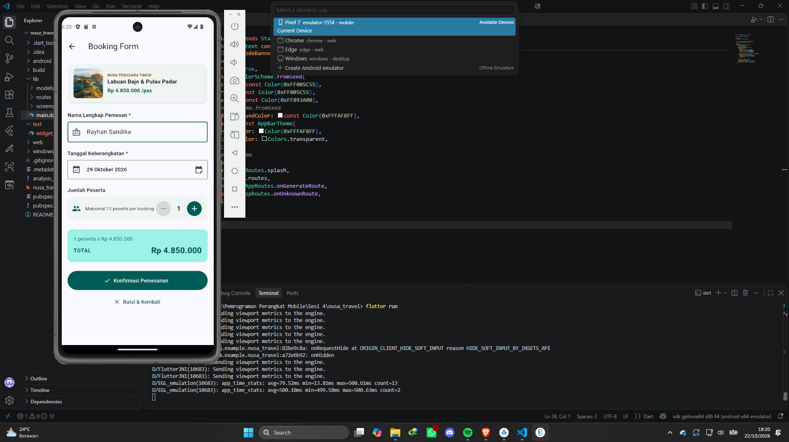
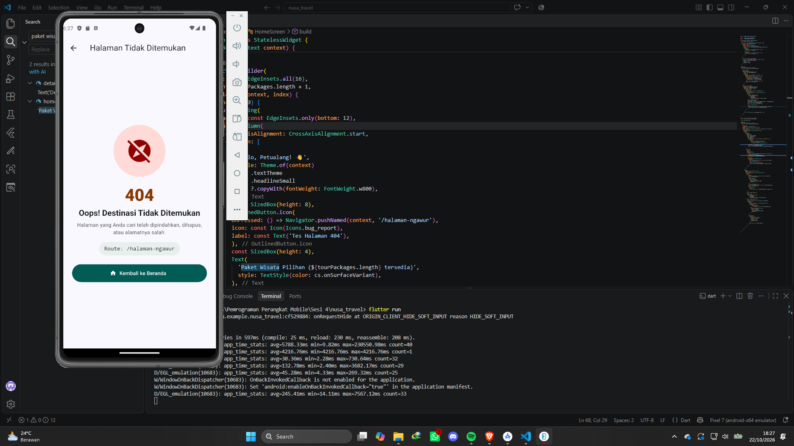
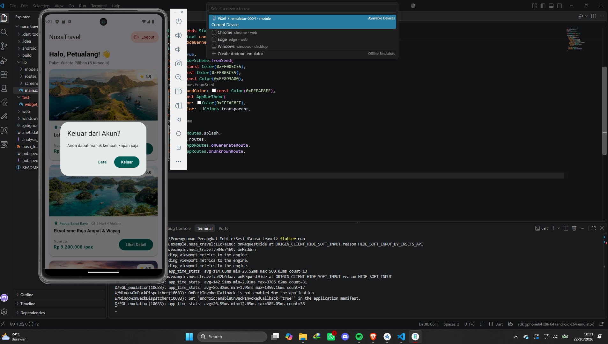
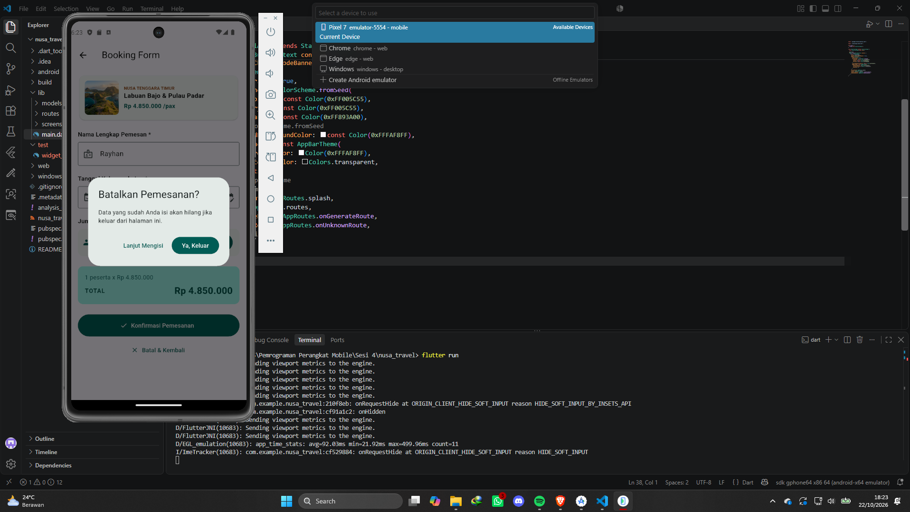
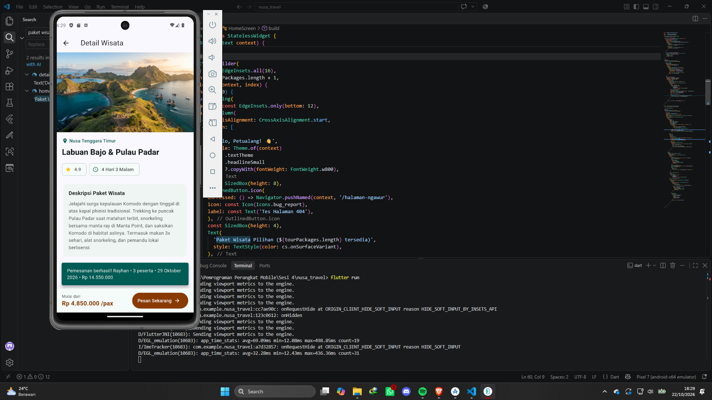

## Tampilan Aplikasi (Emulator Android Studio)

### 1. Halaman Awal / Splash Screen

### 2. Home Screen

### 3. Halaman Detail / Detail Screen

### 4. Halaman Pesan / Booking Screen

### 5. Halaman Error / Not Found (404) Screen

### 6. Popscope Logout dan Popscope Booking

### 7. Snackbar

